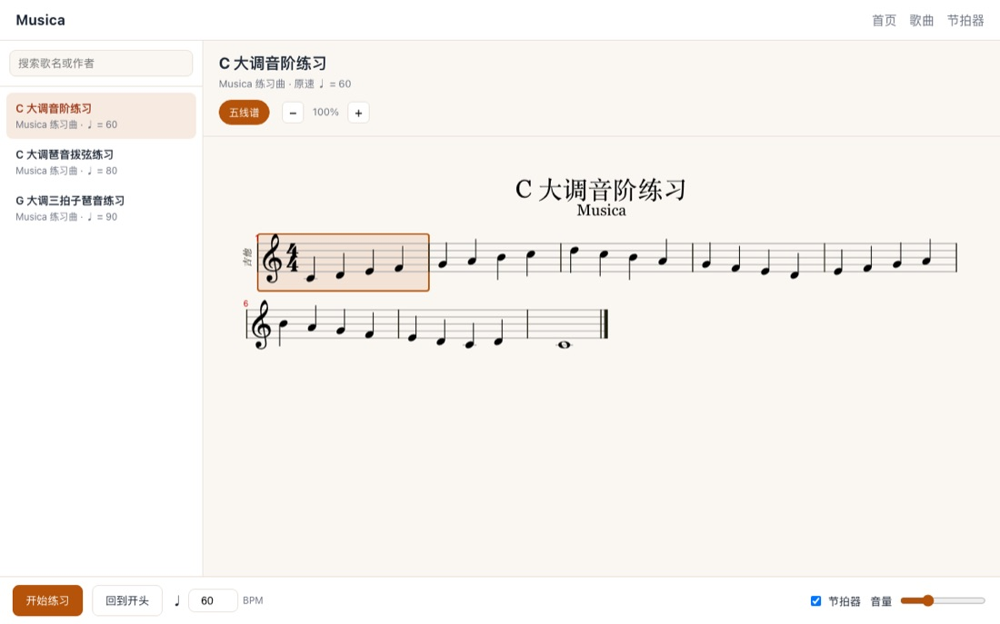

# Musica

个人练琴网站：五线谱 / 六线谱展示、按 BPM 自动跟谱、有声节拍器。

纯静态前端，构建后放到任意静态服务器即可，运行期不需要 Node、数据库或后端服务。



## 功能

- **曲库与跟谱练习**：搜索、五线谱 / 六线谱 / 双谱切换、缩放、按 BPM 自动高亮并滚动到当前小节、内置节拍器，练习设置保存在本地。
- **独立节拍器**：BPM、拍号、循环小节、每拍细分（四分 / 八分 / 三连音 / 十六分），点击节拍切换普通 / 重音 / 跳过，5 种音色，配置本地保存。
- **可深链**：`/songs/practice-001` 这类地址可直接打开，刷新不丢页面。


## 部署

`npm run build` 产出 `dist/`（约 7 MB），把它交给任意静态服务器即可。

> 必须在构建环境里执行 `npm ci && npm run build`：`public/font`、`public/soundfont` 不入库，由构建过程自动生成。

### 一键部署到自己的服务器

先准备部署目标（这个文件在 `.gitignore` 里，不会入库）：

```bash
cp .deploy.env.example .deploy.env
# 填写 DEPLOY_HOST 等字段
```

然后：

```bash
npm run deploy              # 本地构建 + 只推送 dist
npm run deploy -- --remote  # 改在服务器上构建（需 DEPLOY_REMOTE_USER）
npm run deploy -- --dry-run # 只演练，不改服务器
```

| 变量 | 必填 | 默认 | 说明 |
| --- | --- | --- | --- |
| `DEPLOY_HOST` | 是 | — | SSH 目标，`~/.ssh/config` 里的别名或 `user@host` |
| `DEPLOY_DIR` | 否 | `/var/www/musica` | 静态文件目录，Nginx 的 `root` 指向它 |
| `DEPLOY_URL` | 否 | 空 | 填了才会在发布后自动检查首页 / 深链 / 节拍器 |
| `DEPLOY_BASE` | 否 | `/` | 子路径部署时填 `/musica/` |
| `DEPLOY_REMOTE_USER` | 仅 `--remote` | — | 在服务器上执行构建的用户 |
| `DEPLOY_REMOTE_SRC` | 仅 `--remote` | `/opt/musica` | 远端源码目录 |

### Docker

```bash
docker build -t musica .
docker run -d --name musica -p 127.0.0.1:8080:80 --restart unless-stopped musica
```

HTTPS 交给宿主机反向代理或 Caddy；镜像内已包含 Nginx 站点配置。

### 手动部署到 Nginx

```bash
npm ci && npm run build
sudo rsync -a --delete dist/ /var/www/musica/
sudo cp deploy/nginx.conf /etc/nginx/sites-available/musica
# 修改 server_name 与 root /var/www/musica;
sudo ln -s /etc/nginx/sites-available/musica /etc/nginx/sites-enabled/
sudo nginx -t && sudo systemctl reload nginx
sudo certbot --nginx -d musica.example.com
```

[deploy/nginx.conf](deploy/nginx.conf) 已经处理了 SPA 路由回退、`/songs` 目录与路由同名、字体 MIME、静态资源缓存这些容易踩的坑。

### 托管平台

- **Netlify**：仓库已含 [netlify.toml](netlify.toml)，构建命令 `npm run build`、发布目录 `dist`。
- **Vercel**：仓库已含 [vercel.json](vercel.json)，导入仓库即可。
- **Cloudflare Pages**：构建命令 `npm run build`，输出目录 `dist`，开启 SPA 回退。
- **GitHub Pages**：`DEPLOY_BASE=/<仓库名>/ npm run build:pages`，发布 `dist/` 内容。

### 子路径部署

```bash
DEPLOY_BASE=/musica/ npm run build
```

资源路径和路由前缀都会跟着这个值走，深链和刷新都能正常工作。

### 部署后自检

1. 直接打开 `/songs/practice-001` 并刷新，谱面正常显示；
2. `/songs`（不带尾斜杠）返回 200 而不是 403；
3. `/font/Bravura.woff2`、`/songs/index.json` 返回 200；
4. 不存在的 `/assets/nope.js` 返回 404 而不是 `index.html`；
5. 站点使用 HTTPS（浏览器限制音频的部分能力）。

## 本地开发

```bash
npm ci
npm run dev     # http://localhost:5173
```

其他脚本见 `package.json`：`build`、`preview`、`test`、`test:e2e`、`verify:scores`。

## 许可

[MIT](LICENSE)
